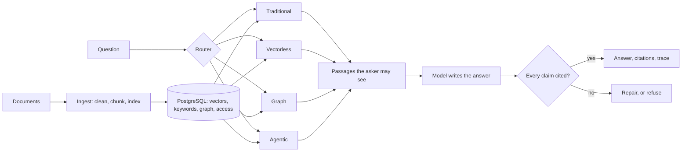
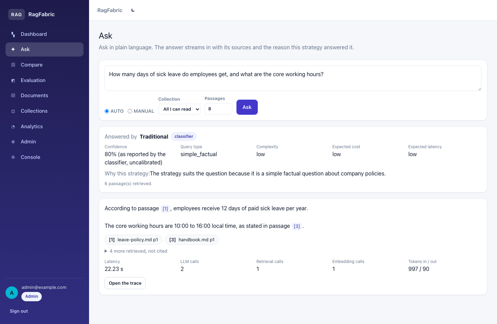
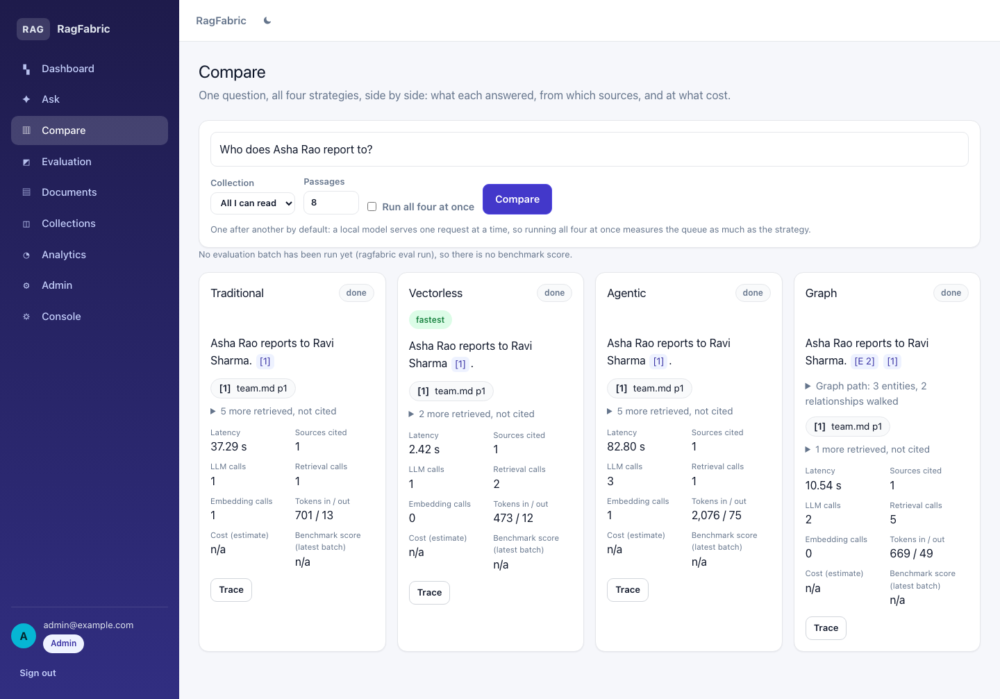
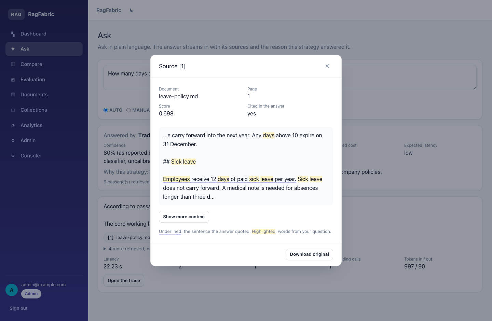
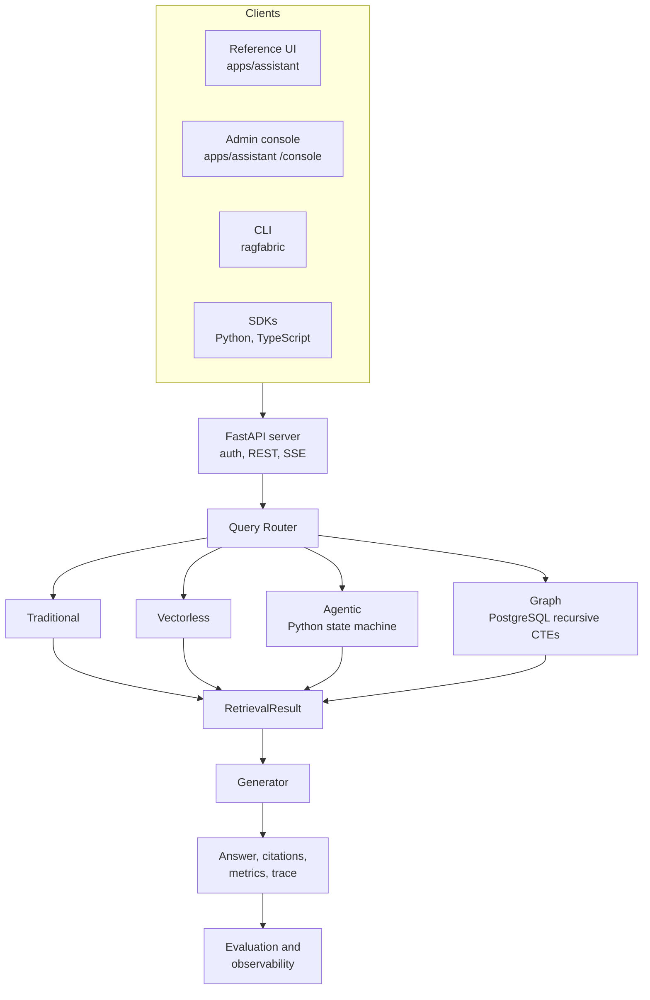

<h1 align="center">RagFabric</h1>

<p align="center">
  <b>Self hosted, measurement first RAG platform.</b><br/>
  Run your documents through four retrieval architectures, measure accuracy, latency and cost on your own corpus,
  then serve the winner behind a query router. Bring your own LLM, database and hosting.
</p>

<p align="center">
  <a href="LICENSE"></a>
  <a href="https://github.com/ranjan-del/ragfabric/actions"></a>
  
</p>

> **Status.** This repository uses three states everywhere: **Released** (in a tagged release and
> exercised end to end), **Implemented, validation pending** (the code is on `main`, but a release, a
> live integration run or quality evidence is still missing) and **Planned** (not built yet). The
> latest release is **v0.4.0**: the four strategies and the query router. Evaluation, the assistant
> UI, the TypeScript SDK, hardening, connectors, deployment guides and the public benchmarks are
> implemented on `main` with validation pending. See [Status at a glance](#status-at-a-glance) and
> [ROADMAP.md](ROADMAP.md). Repository renamed from `enterprise-rag-knowledge-assistant` to
> `ragfabric` on 2026-09-13; old links redirect.

## At a glance

RagFabric answers questions from your own documents with numbered, checkable citations. It runs four
retrieval strategies behind one interface, routes each question to one of them, refuses an answer it
cannot cite, and measures accuracy, latency and cost on your own corpus. Everything runs on your own
machine with a local model; hosted models through an API key are implemented, with no live run recorded
yet. New here? Read
[How RagFabric works, in plain words](docs/how-it-works.md).





| Compare: one question, four strategies | Citation viewer: the exact passage |
|---|---|
|  |  |

**One benchmark.** MultiHop-RAG, 100 documents and 50 questions that each need two or more documents,
answering model `llama3.2:3b` and judge `llama3.1:8b` on one laptop, 25 October 2026 (runs 20 to 24,
43 and 44). LlamaIndex and LangChain search the same chunks with the same embeddings.

| Target | Hit | Correctness | Citation | Refusals |
|---|---|---|---|---|
| RagFabric Traditional | 0.71 | 0.66 | 0.30 | 21 |
| RagFabric Vectorless | 0.78 | 0.65 | 0.38 | 21 |
| RagFabric Auto | 0.73 | 0.66 | 0.36 | 22 |
| LlamaIndex | 0.71 | 0.63 | n/a | 0 |
| LangChain | 0.71 | 0.72 | n/a | 0 |

RagFabric refuses rather than answer without a source, which costs correctness on a 3B model; with a
strong cloud model on the shipped questions it scored 0.91 to 0.97. Full tables, method and losses:
[Benchmark results](#benchmark-results), [evaluation method](docs/evaluation.md),
[Limitations](#limitations).

**Quick start on a clean machine** (Python 3.13 and [uv](https://docs.astral.sh/uv/); no Docker, database
or API key needed):

```bash
git clone https://github.com/ranjan-del/ragfabric.git && cd ragfabric
uv sync
uv run ragfabric quickstart     # config, SQLite, sample documents, a first cited answer
uv run ragfabric doctor         # checks every part and names the fix for anything missing
```

Without a model it runs in offline mode (extractive answers); add a local or hosted model with the
[setup guide](docs/setup.md).

## Status at a glance

| Area | State | Evidence and what is missing |
|---|---|---|
| Ingestion: PDF, DOCX, PPTX, TXT, CSV, Markdown; cleaning, chunking, page numbers | Released (v0.1.0) | Unit and end to end tests; used in every benchmark run |
| Access control: groups, collection grants, document overrides, API keys with rate limits, audit log | Released (v0.1.0) | Filter applied inside every store query, covered by tests; the benchmark leak test is built but not run yet |
| Traditional RAG: pgvector or Chroma, rerankers, citation contract, streaming | Released (v0.1.0) | Benchmarked on MultiHop-RAG and BEIR samples |
| Vectorless RAG: BM25 and PostgreSQL full text with fusion | Released (v0.1.0) | Benchmarked on MultiHop-RAG and BEIR samples |
| Agentic RAG: bounded plan, retrieve, assess, repair loop | Released (v0.2.0) | Benchmarked: slower than Traditional and lower scores on a 3B model; fixes planned |
| Graph RAG: extraction, entity resolution, access checked traversal in PostgreSQL | Released (v0.3.0) | Refuses often on small models; graph benchmark tiers not run yet |
| Query router: auto and manual, fallbacks, reasoning | Released (v0.4.0) | Measured on 50 held-out questions: better than Traditional alone |
| CLI: quickstart, doctor, strategies, ingest, ask, eval | Released (v0.4.0) on GitHub | Quickstart verified from a clean folder; PyPI still holds 0.3.1, the 0.4.0 upload is pending |
| Local model through Ollama, on the same machine | Released (v0.1.0) | The default; used for every benchmark run |
| Hosted models with an API key: OpenAI, Anthropic | Implemented, validation pending | Code in every release since v0.1.0, tested with fakes only; no live run with a key is recorded |
| Any OpenAI compatible endpoint (vLLM, LM Studio, a hosted gateway) | Planned | `llm.base_url` is read only for Ollama today; the OpenAI provider always calls OpenAI |
| Evaluation harness, metrics, `ragfabric eval`, dashboards data | Implemented, validation pending | On `main`; v0.5.0 is not tagged yet |
| Web app: dashboard, documents, collections, Ask, Compare, Trace, Evaluation, analytics, admin, console | Implemented, validation pending | On `main`; checked page by page at desktop and phone widths in light and dark on 25 October 2026; ships with v1.0.0 |
| TypeScript SDK `@ragfabric/sdk` | Implemented, validation pending | On `main`, used by the app and tested; not published to npm |
| Hardening: rate limits, upload validation, request ids, JSON logs | Implemented, validation pending | On `main` and tested; ships with v1.0.0 |
| Watched folder connector | Implemented, validation pending | Verified against a real folder; ships with v1.0.0 |
| Google Drive connector | Implemented, validation pending | Tested with fake HTTP only; no real Drive account has been connected |
| Self hosting on one server: Docker Compose, Caddy HTTPS, local model profile | Implemented, validation pending | Run end to end on a workstation; not yet run on a public server |
| Render, Railway and static host deployment | Implemented, validation pending | Guides written from each provider's documentation; nothing has been deployed |
| Documentation site and release automation | Implemented, validation pending | The site builds in strict mode; its deploy and the PyPI upload are switched off |
| Public benchmarks against LlamaIndex and LangChain | Implemented, validation pending | MultiHop-RAG 100 and BEIR 100 and 1,000 measured; larger tiers, FinanceBench, model sweep, leak test and graph tiers paused at a checkpoint |
| Agentic improvements: ranked evidence, fallback, single shot first, parallel search, multi-hop queries | Planned | Diagnosis and plan in [docs/agentic-rag.md](docs/agentic-rag.md#measured-behaviour-and-next-steps) |
| More providers (Gemini, Azure OpenAI, Bedrock; Voyage and Cohere embeddings) | Planned | |
| OIDC and SAML sign-in, multi tenant workspaces, multi collection filters on the API | Planned | |
| More connectors (Slack, Jira and others), Graph community summaries, a Helm chart | Planned | |

---

## Table of contents

1. [At a glance](#at-a-glance) and [Status at a glance](#status-at-a-glance)
2. [What it is](#what-it-is), and [How it works, in plain words](docs/how-it-works.md)
3. [Why multiple RAG architectures exist](#why-multiple-rag-architectures-exist)
4. [The four strategies](#the-four-strategies)
5. [How to choose a RAG architecture](#how-to-choose-a-rag-architecture)
6. [Query router](#query-router)
7. [Architecture](#architecture)
8. [Everything is configurable](#everything-is-configurable)
9. [Access control](#access-control)
10. [Data and storage](#data-and-storage)
11. [The web app](#the-web-app)
12. [Observability](#observability)
13. [Evaluation methodology](#evaluation-methodology)
14. [Benchmark results](#benchmark-results)
15. [Technology stack](#technology-stack)
16. [Installation](#installation), and the [setup guide](docs/setup.md) for models and hosting
17. [Configuration](#configuration)
18. [Example queries](#example-queries)
19. [Repository layout](#repository-layout)
20. [What works today](#what-works-today)
21. [Limitations](#limitations)
22. [Roadmap and future improvements](#roadmap-and-future-improvements)
23. [Project documentation](#project-documentation)
24. [Contributing](#contributing)
25. [License](#license)

---

## What it is

Most RAG tools give you one retrieval approach and a chat box. RagFabric gives you four retrieval
architectures behind one interface, a router that picks between them per question, and an evaluation
harness that tells you, with numbers from real runs on your documents, which one to use and what it costs.

It is built for teams who need to answer a harder question than "can we do RAG":

> Given our documents, our questions, and our budget, **which** retrieval architecture should we run, and **why**?

Adopters keep their own infrastructure. The LLM provider, embedding model, vector store, lexical store,
graph store, relational database, cache, auth and document connectors are all interfaces with multiple
implementations. The admin console controls who can access which documents. The reference UI is a folder
you can restyle or delete.

It is also a teaching codebase. Every important component explains what it does, why it is needed, how
it works, what the alternatives were and which trade-off was taken.

## Why multiple RAG architectures exist

Retrieval Augmented Generation fetches relevant text before the model answers, so the answer is grounded
in your data rather than the model's memory. The fetch step is the whole game, and there is no single
best way to do it:

| Question shape | What retrieval has to do | Which architecture is built for it |
|---|---|---|
| "What is the parental leave policy?" | Find the passage whose meaning matches | Traditional (vector similarity) |
| "Find invoice INV-2026-0413" | Match an exact token that embeddings blur | Vectorless (lexical) |
| "Compare the 2025 and 2026 travel policies and list what changed" | Retrieve several times, check evidence, refine | Agentic (iterative) |
| "Which teams report to the CTO and what policies apply to them?" | Follow relationships across documents | Graph (entities and edges) |

A production system needs more than one of these, and it needs to know which to use. That is what this
project measures and then automates.

## The four strategies

### Traditional RAG

```
query -> embed -> vector search (top k) -> similarity threshold -> optional rerank -> context -> LLM -> answer + citations
```

Text is tokenised and passed through an embedding model that produces a vector; texts with similar meaning
get vectors pointing in similar directions. Chunks are embedded at ingestion and stored in a vector store
(pgvector or Chroma). At query time the question is embedded with the same model and the nearest chunks
are returned by cosine similarity. A threshold stops the system quoting the nearest neighbour when the
nearest neighbour is unrelated, and an optional reranker re-scores the candidates with a stronger model.

Strong on paraphrase and meaning. Weak on exact identifiers, numbers and rare terms. Lowest latency and
cost of the four.

### Vectorless RAG

```
query -> lexical search (BM25 and PostgreSQL full text) -> fusion -> context -> LLM -> answer + citations
```

No embeddings. BM25 scores a chunk by how often the query terms occur in it (term frequency), how rare
those terms are across the corpus (inverse document frequency), with saturation and length normalisation
controlled by `k1` and `b`. PostgreSQL full text search adds stemming and phrase queries. The two are fused.

Strong on names, IDs, codes, technical terms and known phrases, and it costs nothing to index. Weak on
synonyms and paraphrase, because it matches tokens, not meaning. This is not "keyword search" in the
naive sense: ranking, saturation and length normalisation are what make it competitive.

### Agentic RAG

```
query -> analyze -> decide information need -> retrieve (tools) -> evaluate evidence
      -> enough? no: rewrite query, retrieve again (bounded) | yes: generate -> verify -> answer
```

A plain Python state machine, not LangGraph ([ADR 0009](docs/adr/0009-plain-state-machine-over-langgraph.md)):
typed state, a plain function for each node, and branches in the loop that enforce a hard iteration
budget. The agent can call semantic search, lexical search and fetch-full-document as
tools, judges whether the evidence answers the question, rewrites the query when it does not, and verifies
the final answer against the evidence. Every step is recorded in the trace with its calls, tokens and cost.

Built for multi part, comparative and vague questions. Highest and most variable latency and cost. The
hard engineering problem is stopping correctly, which is why the budget and the evidence evaluation are
first class. Measured on a small local model it does worse than Traditional, because it spends its time
budget searching and then answers from too many passages; the figures and the planned fixes are in
[docs/agentic-rag.md](docs/agentic-rag.md#measured-behaviour-and-next-steps).

### Graph RAG

```
ingest: chunks -> entity extraction -> relationship extraction -> entity resolution -> PostgreSQL (recursive CTEs, source chunk links)
query:  entities in question -> match nodes -> traverse k hops -> collect supporting chunks -> context -> LLM
```

Documents are read once by an LLM that extracts entities (people, organisations, departments, products,
policies, technologies, projects, locations, dates) and the relationships between them. Duplicate entities
are resolved and merged. Every node and edge keeps a link to the chunk it came from, which is what makes
citations possible. A question is answered by finding its entities in the graph, walking relevant edges,
and pulling the source chunks along the path.

Strong on relationship and multi hop questions. Expensive at index time, since every chunk goes through
extraction, and only as good as the extraction. Highest engineering complexity of the four.

## How to choose a RAG architecture

No architecture is universally best. Choose on four axes, then verify with the evaluation harness on
your own corpus.

| Axis | Traditional | Vectorless | Agentic | Graph |
|---|---|---|---|---|
| Latency | Lowest | Low | Highest, variable | Medium |
| Accuracy | Good on direct semantic lookups | Best on exact terms and identifiers | Best on complex and multi part questions | Best on relationship and multi hop questions |
| Cost per query | Lowest | Lowest, no embedding cost | Highest, several LLM calls | Low at query time, high at index time |
| Engineering complexity | Low | Low | Medium | High |
| Choose it when | Most questions are simple lookups | Users search by names, codes, IDs, quotes | Users ask hard questions and will wait | The corpus is entity heavy and questions follow relationships |

**Hybrid approaches** are the norm in production: Traditional plus Vectorless fusion for everyday
questions, the router escalating to Agentic only when the simple path scores low, and Graph enabled only
for corpora whose questions are about relationships. RagFabric's router implements exactly this escalation
and records every fallback, so the hybrid behaviour is observable rather than assumed.

## Query router

`strategy: auto` chooses a strategy per question. Naming a strategy bypasses the router, so every
strategy can be tested independently. Two stages, cheap first. Free signals (identifiers, quoted
phrases, relation phrases with a named entity, comparison and aggregation words, question length)
decide when exactly one rule fires, with no model call. Otherwise one small classification call
decides, and when it is unsure the router fuses Traditional and Vectorless instead of guessing.
It returns:

```json
{
  "selected_strategy": "agentic",
  "source": "classifier",
  "decisive": false,
  "confidence": 0.87,
  "reasoning": "The question compares two policies across documents and may need more than one retrieval.",
  "query_type": "comparison",
  "estimated_complexity": "high",
  "expected_cost_level": "high",
  "expected_latency_level": "high",
  "fused": false
}
```

The reasoning is a short, user safe explanation. A signals decision has `confidence: null`, because a
rule that fired is not a measurement. A classifier confidence is what the model reported and is
not calibrated. When a strategy returns no usable evidence, one fallback to Traditional
runs and the run records `fallback_from`. `auto` never exceeds the caller's `max_llm_calls`. The
agent also uses the signals to correct its planner's tool choice, and can reach the graph through an
opt-in `graph_search` tool. On 50 held-out MultiHop-RAG questions with `llama3.1:8b`, `auto` scored
0.55 correctness against 0.40 for Traditional on the same retrieval (batch `h2-heldout-before`, runs 5
and 6). See
[docs/routing.md](docs/routing.md).

## Architecture



Every strategy implements one interface and returns one result shape:

```python
class RetrieverStrategy(Protocol):
    def retrieve(self, query: str, ctx: RetrievalContext) -> RetrievalResult: ...
```

`RetrievalResult` carries the chunks with their source metadata, relevance scores where available, the
number of retrieval and LLM calls, tokens, latency, a trace and an optional `fallback_from`. Generation,
citation checking, metrics and evaluation run the same code regardless of which strategy produced it.
That is what makes the comparison fair.

All four strategies, the router and the agent implement this interface today; the detailed layering,
request flow and data model are in [docs/architecture.md](docs/architecture.md).

Dependency direction is strict: UIs depend on the SDK, the SDK on the HTTP contract, the server on the
engine, the engine on its own interfaces. Provider and store implementations plug in from outside.

## Everything is configurable

One `ragfabric.yaml` plus environment variables for secrets. Each row is an interface with at least two
implementations, so swapping is configuration, not code.

| Concern | Interface | Implementations (state) |
|---|---|---|
| LLM | `LLMProvider` | Ollama on the same machine (released) or on another server (implemented, validation pending); OpenAI and Anthropic with an API key (implemented, no live run recorded); offline test double (released). Any OpenAI compatible endpoint (planned) |
| Embeddings | `EmbeddingProvider` | Ollama (released); OpenAI (implemented, no live run recorded); offline hashing for tests (released) |
| Reranker | `Reranker` | none, LLM rerank, cross encoder (released) |
| Vector store | `VectorStore` | PostgreSQL pgvector, Chroma (released) |
| Lexical store | `LexicalStore` | PostgreSQL full text, BM25 in SQL, in process BM25 (released) |
| Graph store | none, walked directly in the relational schema | PostgreSQL recursive CTEs, or disabled (released) |
| Relational DB | SQLAlchemy | PostgreSQL, SQLite for development (released) |
| Cache and rate limits | `Cache` | Redis, in memory (released) |
| Auth | `AuthProvider` | Local users with JWT, API keys (released); OIDC and SAML (planned) |
| Document sources | `Connector` | Upload (released); watched folder, Google Drive (implemented, validation pending); Slack, Jira and others (planned) |
| Telemetry export | OpenTelemetry | OTLP to any backend, off by default (released) |

## Access control

Roles per workspace, groups with read or write grants on collections, per document overrides, scoped and
rate limited API keys, and an audit log of every run. The permitted document set is computed once per
request and applied **inside** every store query, so a chunk the caller may not read is never ranked,
never enters the model context and never appears in a citation. The policy lives in the engine, not the
UI, so replacing the UI cannot remove it. The admin console manages all of this.

A collection with no grants is open to every signed in user; the first grant restricts it to its
grantees.

## Data and storage

Everything lives in one PostgreSQL database (version 18 with the pgvector extension); SQLite works for
development and the quickstart. The schema is created and upgraded only by Alembic migrations
(`ragfabric db upgrade`), currently nine, ending at `0009_connector_items`, and CI applies them against a
real PostgreSQL on every pull request.

| Group | Tables |
|---|---|
| Documents | `collections`, `documents`, `chunks`, `ingestion_runs`, `connector_items` |
| Search indexes | `chunk_embeddings` (vectors, HNSW index, 768 dimensions), `chunk_search` (full text), `term_stats` and `corpus_stats` (BM25) |
| Knowledge graph | `entities`, `relationships`, `entity_sources`, `relationship_sources`, `entity_merges` |
| Access | `users`, `groups`, `group_members`, `collection_grants`, `document_overrides`, `api_keys`, `audit_log` |
| Questions and answers | `conversations`, `messages`, `retrieval_runs`, `sources`, `query_logs` |
| Evaluation | `evaluation_runs`, `evaluation_results` |

Chroma can replace pgvector for vectors (`vector_store.kind: chroma`), and Redis holds rate limit
counters and, when indexing is queued, the ingestion queue. Uploaded originals are kept on disk under
`ingestion.uploads_dir`. The embedding dimension is pinned by migration 0004, so changing to a model
of another dimension needs a migration ([docs/configuration.md](docs/configuration.md)).

## The web app

An Angular app (`apps/assistant`) that reaches the server only through the TypeScript SDK. State:
implemented, validation pending (on `main`, ships with v1.0.0).

| Page | What it is for |
|---|---|
| Login | Sign in; the session survives a rate limit or a server error and ends only on a 401 |
| Dashboard | Recent questions, top documents and a starting point for asking |
| Documents | Upload, list and remove documents, and download an original |
| Collections | Create collections and see what each holds |
| Ask | Ask in auto or manual mode; the router's choice and reason, the streamed answer and clickable citations |
| Compare | One question through all four strategies side by side, with sources, time, calls, tokens and cost |
| Trace | One run as a waterfall of steps, with timings, counts, routing and sources |
| Evaluation | The latest measured batch, scores by question type and the live dashboards |
| Analytics | Counts of documents, collections, indexed chunks, users and questions, and the most indexed documents |
| Admin | The user list with each user's status and actions |
| Console (admins) | Users, groups, grants, API keys and their rate limits, and the answering and embedding model settings |

How to read each page: [docs/assistant.md](docs/assistant.md).

## Observability

One trace per request with spans for the router, each retrieval call, each LLM call, generation and
citation checking, each agent node and each graph traversal. LLM spans carry tokens and estimated cost.
Traces are stored for the built in Trace page and dashboards (latency percentiles, cost per day, calls per
strategy, fallback rate, quality trend) and exported over OTLP when configured.

Every response carries an `X-Request-ID`, and every log line written while serving it, including the
lines libraries such as the HTTP client write, carries the same id. `logging.format: json` writes one
JSON object per line for a log shipper ([docs/operations.md](docs/operations.md)).

## Evaluation methodology

The repository ships a synthetic company corpus and a `questions.json` with eight categories: simple
factual, multi document, multi hop, comparison, relationship, exact match, ambiguous, complex reasoning.
Each test case has a question, expected answer, expected sources, type and difficulty. You can add your
own questions over your own corpus.

| Family | Metrics |
|---|---|
| Retrieval | precision, recall, hit rate, mean reciprocal rank against expected sources |
| Generation | answer correctness, faithfulness, context relevance, citation correctness (LLM judge with a fixed rubric plus a deterministic citation check) |
| System | total, retrieval and generation latency; LLM and retrieval calls; input and output tokens; estimated cost |
| Engineering | complexity score 1 to 5 (infrastructure, components, operations, debugging, maintenance), labelled as an engineering assessment, not measured data |

`make eval` runs the full set through all four strategies, stores every run, and regenerates
`docs/benchmarks/latest.md` with the commit, models and date that produced it.

## Benchmark results

Every number below comes from a stored run, named by its run id, on one laptop (Apple M1, 16 GB), with
the commit each ran on recorded in the full tables. Each is one run on a small sample, not a general
claim (ADR 0004).
Full tables: [comparison](docs/benchmarks/comparison.md), [model sweep](docs/benchmarks/results/model-sweep.md),
the [latest shipped-set run](docs/benchmarks/latest.md), and a [feature comparison with the wider
market](docs/benchmarks/landscape.md) from published documentation.

**With a strong cloud model.** The 24 shipped questions, retrieved by RagFabric and answered by two cloud
models from the exported prompts (runs 7 to 10), against the local `llama3.1:8b` on the same retrieval
(runs 1 and 2). The shipped questions were written alongside the system, so they favour it.

| Strategy | Answering model | Correctness | Citation |
|---|---|---|---|
| Traditional | Claude Sonnet 5.5 | 0.97 | 0.92 |
| Traditional | Claude Haiku 5.5 | 0.91 | 0.92 |
| Traditional | `llama3.1:8b` (local) | 0.83 | 0.92 |
| Vectorless | Claude Sonnet 5.5 | 0.94 | 0.92 |
| Vectorless | Claude Haiku 5.5 | 0.93 | 1.00 |
| Vectorless | `llama3.1:8b` (local) | 0.87 | 0.92 |

**With a small local model, against LlamaIndex and LangChain.** MultiHop-RAG, 100 documents and 50
questions that each need two or more documents, answered by `llama3.2:3b` and judged by `llama3.1:8b`
(runs 20 to 24, 43 and 44). The two frameworks search RagFabric's own chunks with the same embedding
model, so their retrieval matches Traditional.

| Target | Hit | MRR | Correctness | Citation | Refusals | p50 |
|---|---|---|---|---|---|---|
| Traditional | 0.71 | 0.59 | 0.66 | 0.30 | 21 | 5.2 s |
| Vectorless | 0.78 | 0.65 | 0.65 | 0.38 | 21 | 4.2 s |
| Traditional with cross encoder rerank | 0.83 | 0.67 | 0.52 | 0.26 | 26 | 4.3 s |
| Auto (router) | 0.73 | 0.57 | 0.66 | 0.36 | 22 | 6.0 s |
| Agentic | 0.66 | 0.49 | 0.53 | 0.22 | 27 | 40.7 s |
| LlamaIndex | 0.71 | 0.59 | 0.63 | n/a | 0 | 5.3 s |
| LangChain | 0.71 | 0.59 | 0.72 | n/a | 0 | 5.4 s |

What it says:

- **Finding documents is strong**, and on the BEIR samples vector search found a relevant document for
  0.88 to 1.00 of questions (runs 25, 30 and 35) in tens of milliseconds.
- **Answer quality depends mostly on the model.** A strong cloud model gives accurate, well cited
  answers; a 3B local model gives fair answers and weak citations on hard questions.
- **RagFabric refuses rather than answer without a source.** That costs correctness on a small model:
  LangChain, which never refuses and gives no citations, scored higher here.
- **Agentic needs work on small models**: it is the slowest and scored lowest
  ([why, and the fixes](docs/agentic-rag.md#measured-behaviour-and-next-steps)).
- **Not run yet**: the full BEIR tiers, FinanceBench, the model sweep, the access leak test and the
  graph tiers. Phase 11 is paused at a checkpoint and resumes from the same batches
  ([resuming](docs/benchmarks/README.md#resuming-the-runs)).

## Documentation

| Read | For |
|---|---|
| [docs/getting-started.md](docs/getting-started.md) | Install and first question |
| [docs/architecture.md](docs/architecture.md) | Layers, request flow, data model |
| [docs/traditional-rag.md](docs/traditional-rag.md), [vectorless-rag.md](docs/vectorless-rag.md), [agentic-rag.md](docs/agentic-rag.md), [graph-rag.md](docs/graph-rag.md) | One document per strategy: what, why, internals, trade offs, failure modes |
| [docs/routing.md](docs/routing.md) | Router decision, signals, fallbacks, budget |
| [docs/evaluation.md](docs/evaluation.md) | Dataset, metrics, judges, `ragfabric eval`, `make eval` |
| [docs/complexity.md](docs/complexity.md) | Engineering complexity assessment per strategy (an assessment, not a measurement) |
| [docs/assistant.md](docs/assistant.md) | The Ask, Compare, Trace and Evaluation pages and how to read them |
| [packages/sdk-typescript](packages/sdk-typescript/README.md) | `@ragfabric/sdk`: the TypeScript client |
| [docs/configuration.md](docs/configuration.md), [providers.md](docs/providers.md) | `ragfabric.yaml`, environment, provider and store matrix |
| [docs/troubleshooting.md](docs/troubleshooting.md) | Symptoms, causes, fixes |
| [docs/connectors.md](docs/connectors.md) | Keeping a watched folder or a Google Drive folder in sync |
| [docs/deployment.md](docs/deployment.md), [operations.md](docs/operations.md) | Running it for other people: single VM with HTTPS, Render, Railway, a static host; logs, request ids, rate limits, backups, upgrades |
| [docs/releasing.md](docs/releasing.md) | The version script and the guarded release workflow |
| [docs/adr](docs/adr), [docs/design](docs/design) | Decisions and the full design |

## Technology stack

| Layer | Choice |
|---|---|
| Engine and API | Python 3.13, FastAPI, Pydantic, SQLAlchemy, Alembic |
| Agents | Plain Python state machine, no framework (ADR 0009) |
| Stores | PostgreSQL 18 with pgvector, Chroma, Redis |
| Frontend | Angular 22, TypeScript 6, Tailwind 4 |
| Tooling | uv, Node 24, Docker Compose, GitHub Actions, OpenTelemetry |

Frameworks are used where they pay for themselves. Retrieval logic is written out and readable rather
than hidden behind a single library call.

## Installation

Connecting a local or hosted model, running the web app, hosting it for others and using the API
and SDKs are all in the [setup guide](docs/setup.md), with the state of each option.

### Five minute start

You need Python 3.13. No Docker, database server or API key is required.

```bash
pip install ragfabric
ragfabric quickstart
ragfabric doctor
```

PyPI currently holds 0.3.1, which predates `quickstart`; until 0.4.0 is published, install from a
checkout instead: `git clone https://github.com/ranjan-del/ragfabric && cd ragfabric && uv sync`, then
run the same commands with `uv run` in front.

`ragfabric quickstart` works in the current directory (or `--dir PATH`). It writes `ragfabric.yaml`
and `.env` from templates packaged with the install when they are missing, picks a model, sets up
SQLite, migrates, ingests a small sample corpus, asks a sample question through a temporary server
and prints the cited answer. The temporary server stops when quickstart ends. When quickstart wrote
`.env` itself (mode 0600), it also creates an API key and stores `RAGFABRIC_API_KEY` and
`RAGFABRIC_URL` there. When `.env` already existed it is kept, no key is written, and quickstart
prints the one command that creates a key.

To ask your own questions, start the server in a second terminal, in the same directory, and ask
from the first:

```bash
ragfabric serve
ragfabric ask "your question about the sample documents"
```

How it picks a model:

| Found | Used |
|---|---|
| Ollama running with a chat model and `nomic-embed-text`, and the openai extra installed | Ollama |
| `OPENAI_API_KEY` set, and the openai extra installed | OpenAI |
| `ANTHROPIC_API_KEY` set, and the anthropic extra installed | Anthropic, with offline embeddings |
| None of the above | Offline mode. Quickstart labels it: answers are extractive and limited |

Quickstart never downloads a model for you and never overwrites `ragfabric.yaml` or `.env` without
`--force`. When Ollama is running but a model is missing, it prints the `ollama pull` command; when an
extra is missing, it prints `pip install 'ragfabric[openai]'` (or `[anthropic]`). A rerun continues where the last run stopped. `--docker` uses PostgreSQL and Redis from a packaged
compose file instead of SQLite, `--yes` skips prompts, and `--no-model-check` skips the Ollama probe
(`--model-check` is the default).

To move from offline mode to a real model later, keep `.env` and re-run setup (never `--force`):

```bash
mv ragfabric.yaml ragfabric.yaml.bak
ragfabric quickstart
ragfabric reindex --yes
```

`ragfabric doctor` checks Python, config, database, migrations, the LLM, embeddings, graph and the
server. Each check reports pass, warn, fail or skip with a fix for a failure, and the exit code is 1
if anything failed. A skipped check says skipped. `--no-network` skips the provider and server calls
(an offline provider still reports warn), `--url` points it at a server, and `--json` is for
scripts. `ragfabric strategies` lists the five strategies, what each is best at, a relative cost and
an example question. Bare `ragfabric` shows a welcome screen, and `ragfabric --debug <command>`
prints the full traceback.

Something wrong? See [docs/troubleshooting.md](docs/troubleshooting.md#errors-the-cli-explains).

### From source with Docker Compose

Two compose profiles. `lite` is four services (PostgreSQL with pgvector, Redis, API, UI) and is
enough for Traditional and Vectorless RAG. `full` adds Chroma for all four; the knowledge graph
lives in PostgreSQL, not a service of its own (ADR 0011).

```bash
git clone https://github.com/ranjan-del/ragfabric.git
cd ragfabric
cp .env.example .env && cp ragfabric.example.yaml ragfabric.yaml
docker compose up --build                  # lite: PostgreSQL with pgvector, Redis, API, UI
docker compose --profile full up --build   # adds Chroma
```

Then open the UI, sign in with the bootstrap admin from your `.env`, upload documents, and ask.
The compose stack listens on localhost only and seeds a development admin; before exposing it on a
network follow the production notes in docs/configuration.md.

## Configuration

```yaml
# ragfabric.yaml (abridged; every key is annotated in ragfabric.example.yaml)
llm:        { provider: openai, model: gpt-4.1-mini }
embeddings: { provider: openai, model: text-embedding-3-small }
vector_store:  { kind: pgvector }
lexical_store: { kind: postgres_fts }
graph_store:   { kind: postgres, enabled: false }
strategies:
  traditional: { top_k: 5, similarity_threshold: 0.25, rerank: none }
  agentic:     { max_iterations: 4 }
router: { mode: auto, min_confidence: 0.6 }   # mode resolves an unset strategy; min_confidence is the fuse threshold
limits: { max_cost_per_query_usd: 0.05, max_latency_ms: 20000 }
```

Secrets stay in the environment: `OPENAI_API_KEY`, `ANTHROPIC_API_KEY`, `DATABASE_URL`, `JWT_SECRET`.
See `.env.example`. Pricing used for cost estimates lives in `pricing.yaml` and is
labelled as an estimate everywhere it is shown.

## Example queries

| Query | Expected route | Why |
|---|---|---|
| "How many days of casual leave do interns get?" | Traditional | Direct semantic lookup |
| "Show me policy HR-POL-2026-07" | Vectorless | Exact identifier |
| "Compare the 2025 and 2026 leave policies and list what changed" | Agentic | Comparison across documents, may need more than one retrieval |
| "Which teams report to the CTO and which security policies apply to them?" | Graph | Relationships across people, teams and policies |

Manual mode lets you force any strategy on any query and compare the four side by side.

## Repository layout

```
packages/core            engine: strategies, router, agent, graph, ingestion, evaluation, access policy, providers, stores, migrations
packages/server          FastAPI application: REST and SSE API, auth, rate limits
packages/cli             the ragfabric command (published to PyPI as ragfabric)
packages/sdk-python      typed Python client, HTTP only
packages/sdk-typescript  typed TypeScript client (@ragfabric/sdk), generated from the OpenAPI spec
apps/assistant           the web app (Angular), including the admin console under /console
benchmarks               public benchmark runners, LlamaIndex and LangChain adapters, the leak test, summarise.py
deploy/docker            API and web app images, nginx configuration
deploy/compose           production compose stack with Caddy for HTTPS and optional local model and connectors
deploy/render            RagFabric configuration for the Render Blueprint (render.yaml at the root)
docs                     guides, concepts, strategies, ADRs, design, benchmarks, learning notes
scripts                  release tooling (version bump)
docker-compose.yml       development stack: lite by default, full adds Chroma, workers adds the queue worker
ragfabric.example.yaml   every configuration key, annotated
```

The evaluation corpus and questions live in `packages/core/src/ragfabric_core/evaluation/data/` so an
installed package has them.

Design details: [docs/design/2026-09-13-ragfabric-design.md](docs/design/2026-09-13-ragfabric-design.md)
and the ADRs in [docs/adr](docs/adr).

## What works today

What each phase added, oldest first. The v1 base is a complete single strategy assistant that runs
offline with no API key:

- Ingestion for PDF, DOCX, PPTX, TXT, CSV and Markdown with page numbers and character spans that survive into citations
- Chunking with overlap, a deterministic hashing embedder
- Semantic and hybrid retrieval, an extractive answer generator whose every clause is a verbatim quote from a numbered source, with relevance floors on citations
- JWT auth, two role RBAC, bootstrap admin, production safety rails, Alembic migrations with a drift test
- Angular app with login, dashboard, upload, ask, collections, analytics and admin pages
- 107 backend tests and 20 frontend tests, CI runs the migrations against real PostgreSQL

Phase 2 added a shared ingestion and access control foundation underneath the v1 path:

- Configurable cleaning (hyphenation repair, whitespace and repeated header and footer removal),
  heading detection and chunking, with chunk size and overlap read from `ragfabric.yaml`
- Retained original files under a configurable uploads directory, with a download route and deletion
  on document delete
- A pgvector vector index and a PostgreSQL full text index, written by the ingestion fan out either
  inline or through Redis backed workers
- Groups, collection grants, per document overrides and hashed API keys with rate limits
- An `AccessFilter` computed per request and applied inside every store query
- A retrieval run, its sources and an audit row recorded per query, readable at `GET /api/runs/{id}`
- Tracing spans across ingestion and retrieval with optional OTLP export
- CLI commands `init`, `ingest`, `users`, `groups`, `grants`, `keys`, `worker`

Phase 3 shipped Traditional RAG and pointed the query path at the indexes Phase 2 had been writing but
not yet reading:

- Real embeddings through Ollama (`nomic-embed-text`, the no key default) or OpenAI, L2 normalised at
  write time so cosine distance and dot product agree across PostgreSQL and SQLite
- A pgvector index with a fixed 768 dimension and an HNSW cosine index (migration 0004), queried by the
  API for the first time; Chroma as an alternative store, selected with `vector_store.kind: chroma`
- Per request `similarity_threshold`, metadata filters, an optional reranker (`none`, `llm`, or
  `cross_encoder` with the `ragfabric[rerank]` extra), and a context budget that drops whole low ranked
  chunks rather than splitting one, because a split chunk's character span no longer matches what was
  stored and citations would point at the wrong text
- LLM written answers with numbered citations verified against a mechanical citation contract: every
  `[n]` marker must point at a retrieved chunk, every long or digit bearing quoted span must appear in
  that chunk, and an answer with evidence available must carry a citation. The contract does not, and
  cannot, verify that a paraphrase is faithful to its source; that is a semantic judgement and Phase 8
  measures it
- `POST /api/ask`, manual mode, with SSE streaming (`retrieval`, `token`, `citations`, `done`, and
  `superseded` when a streamed answer fails the citation contract and is transparently replaced)
- The Python SDK (`ragfabric_sdk`), talking HTTP only
- CLI commands `ragfabric ask`, `ragfabric reindex` and `ragfabric reconcile`

Queries now run against `chunk_embeddings` (pgvector or Chroma) and `chunk_search`; the v1 in memory
index queries used before this phase are gone. The Python test suite is 385 passed, 12 skipped (live
provider and PostgreSQL/Chroma integration tests that run in CI, plus a `tiktoken` check).

**Phase 3 did not measure answer quality.** The engine produces a grounded, cited answer, and a real run
against a local `llama3.2:3b` model confirms the mechanism works end to end, including the case where
the model's first attempt omitted the citation marker entirely and the contract forced a repair. What
this phase does not do is score whether answers are correct, complete or faithful across more than a
single, deliberately simple test document; that measurement, with a real question set and a scoring
harness, came with Phase 8 and Phase 11; see [Benchmark results](#benchmark-results).

Phase 8 (v0.5.0, unreleased) adds that harness: a shipped synthetic corpus and 24 questions in eight
categories, retrieval metrics (precision, recall, hit rate, MRR), generation metrics from a fixed-rubric
LLM judge or a deterministic lexical one, a deterministic citation check, latency, calls, tokens and
estimated cost per answer, and a router-versus-best-strategy comparison. `ragfabric eval corpus`,
`ragfabric eval run`, `list`, `show` and `report` drive it; `make eval` writes
[docs/benchmarks/latest.md](docs/benchmarks/latest.md); `/api/eval/runs` and `/api/eval/dashboard` serve
the stored runs and the dashboard data. Every ask now records its model and estimated cost. See
[docs/evaluation.md](docs/evaluation.md).

Phase 9 (on `main`, to be released in v1.0.0) adds the assistant pages and the TypeScript SDK:

- **Ask**: AUTO or MANUAL, a router decision card (strategy, rule or classifier, confidence as
  reported, reasoning, fallback), the answer streamed token by token, corrected in place when the
  server supersedes it, and clickable citations that open a source viewer
- **Compare**: one question across the four strategies side by side, with each column's answer,
  sources, latency, calls, tokens, estimated cost from the stored run and the strategy's latest
  benchmark score (labelled as such, never a score for that question)
- **Trace**: one run's spans as a waterfall, latency split, counts, cost, routing and sources
- **Evaluation**: the latest batch, a per category breakdown and the live dashboards, reading the
  evaluation API that v0.5.0 adds
- **`@ragfabric/sdk`**: types generated from the server's OpenAPI specification, request builders, an
  SSE decoder and a `fetch` client with no runtime dependencies. The app reaches the server only
  through it, checked in CI. Prepared for npm, not yet published

See [docs/assistant.md](docs/assistant.md) and ADR 0016.

Phase 10 (hardening, on `main`, not yet released) makes it fit to run for other people:

- Request ids on every response and structured JSON logs carrying them
- Rate limits for signed-in users and per address on sign-in, alongside the per API key limit, with
  `Retry-After`; uploads checked for content matching their extension, zip bombs refused before
  decompression, and the size bounded on the wire
- Connectors: a watched folder and a Google Drive folder, synced by `ragfabric connectors sync`
- An end-to-end test from upload to cited answer through the SDK, on SQLite and on PostgreSQL in CI
- A production compose stack with Caddy for HTTPS, a Render Blueprint, guides for Railway and static
  hosts, a documentation site built with MkDocs, and a release workflow that refuses a tag that does
  not match the code

```bash
uv sync                       # Python 3.13 workspace: core, server, cli
uv run ragfabric db upgrade
uv run ragfabric serve --reload            # API on :8000
cd apps/assistant && npm ci && npm start   # UI on :4200, /api proxied to :8000
```

The hashing embedder and extractive generator are kept in RagFabric as the no key test double, which is
why the test suite stays green without secrets. An Ollama only deployment still needs the `openai`
extra installed, because Ollama is served through the OpenAI compatible client; see
[docs/configuration.md](docs/configuration.md).

## Limitations

- Pre 1.0. v0.4.0 is the latest release; Phases 8 to 11 are on `main` and unreleased, and what is still
  planned carries a phase number in [ROADMAP.md](ROADMAP.md).
- The four strategies need a real LLM and embedding provider. Ollama is the free path; quality depends on the local model.
- Graph RAG quality is bounded by extraction quality, and extraction costs one LLM call per chunk at index time.
- Agentic RAG latency is variable by design. The budget caps it, but it will always be the slowest. On a
  3B local model it also scores below Traditional today (see [Benchmark results](#benchmark-results)).
- Graph RAG refuses when the model leaves out citation markers, so on small models it answers few questions.
- Answer quality depends mostly on the answering model: a 3B or 8B local model gives fair answers and
  weak citations on hard questions, a strong cloud model gives much better ones on the same retrieval.
- Single workspace per install. Multi tenancy is not planned before v1.0.
- Evaluation with an LLM judge has its own bias; the deterministic citation check is the ground truth for citations.

## Roadmap and future improvements

See [ROADMAP.md](ROADMAP.md) and [CHANGELOG.md](CHANGELOG.md).

| Release | Theme | State |
|---|---|---|
| v0.1.0 | Initial RAG engine: interfaces, providers, ingestion, access control, Traditional and Vectorless RAG, CLI, Python SDK, console | Released 22 September 2026 |
| v0.2.0 | Agentic retrieval with a plain Python state machine, not LangGraph | Released 26 September 2026 |
| v0.3.0 | Graph retrieval on PostgreSQL recursive CTEs (v0.3.1 added PyPI packaging) | Released 26 September 2026 |
| v0.4.0 | Adaptive router with fallbacks, the agent routing each sub-question across all four strategies, terminal experience | Released 7 October 2026 (on GitHub; PyPI upload pending) |
| v0.5.0 | Evaluation framework, dashboards, generated benchmarks | Implemented, validation pending: on `main`, not tagged |
| v1.0.0 | Production release: web app with Compare and Trace, TypeScript SDK, connectors, hardening, docs site, deployment guides, public benchmarks with a fix wave | Implemented, validation pending: on `main`; benchmarks paused at a checkpoint, Drive and hosted deployments not yet validated, npm and PyPI not published |

Planned after v1.0.0: any OpenAI compatible endpoint, more providers, OIDC and SAML, multi tenant
workspaces, more connectors and stores, community summaries for Graph RAG, a Helm chart, and the
agentic improvements in [docs/agentic-rag.md](docs/agentic-rag.md#measured-behaviour-and-next-steps).

## Project documentation

Every flagship repository documents the same ten things. Status shows what exists today.

| Section | Document | Status |
|---|---|---|
| README | [README.md](README.md) | Written |
| Architecture | [docs/architecture.md](docs/architecture.md) | Written |
| Design decisions | [docs/adr/](docs/adr/) | Written |
| Benchmarks | [docs/benchmarks/README.md](docs/benchmarks/README.md) | Partial (Phase 11 paused at a checkpoint on 25 October 2026) |
| Failure cases | [docs/failure-cases.md](docs/failure-cases.md) | Partial |
| Evaluation | [docs/evaluation.md](docs/evaluation.md) | Written |
| Trade-offs | [docs/trade-offs.md](docs/trade-offs.md) | Partial |
| Deployment | [docs/deployment.md](docs/deployment.md) | Written (guides; the single VM stack was run on a workstation, nothing is deployed by the project) |
| Cost | [docs/cost.md](docs/cost.md) | To be written |
| Future work | [ROADMAP.md](ROADMAP.md) | Written |

## Contributing

Fork, branch, open a pull request. `main` is protected and only changes through reviewed PRs with green
CI. Read [CONTRIBUTING.md](CONTRIBUTING.md) for the flow, the ground rules (no fabricated numbers, no
placeholder features, access control inside retrieval) and the development setup. Security issues go
through [SECURITY.md](SECURITY.md).

## License

Apache License 2.0. See [LICENSE](LICENSE) and [NOTICE](NOTICE).

In plain words: use it commercially, modify it, host it, combine it with proprietary code, all without
paying or publishing your changes. Keep the license and copyright notices when you redistribute, and
state what you changed. Every contributor also grants a patent license, so no contributor can later sue
users over their own contribution. The name RagFabric is not licensed for your own products.

Contributors sign a one time [Contributor License Agreement](CLA.md) by posting one sentence on their
first pull request; a GitHub Action checks it. Full explanation, including why Apache 2.0 rather than MIT
or a copyleft license, in [docs/licensing.md](docs/licensing.md).
