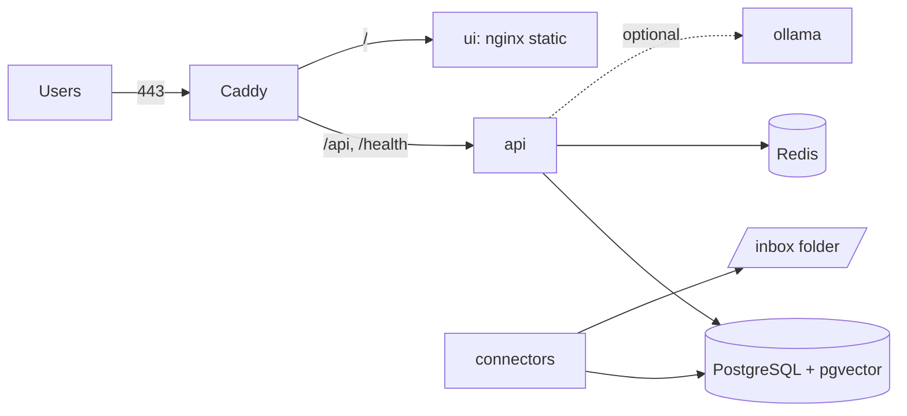

# Single VM with Docker Compose

> Status: started and exercised end to end on a workstation under Docker (see
> [the first run](../learning/hardening-first-run.md)), with `DOMAIN=localhost` and Caddy's local
> certificate authority. The project has not run it on a public server with a real domain, so the
> certificate step below follows Caddy's documentation.

One machine runs everything: Caddy for HTTPS, the API, the web app, PostgreSQL with pgvector and
Redis, plus optional profiles for a local model server, a watched folder and a background worker.
It is the cheapest complete way to run RagFabric for other people.



Only Caddy publishes ports. Everything else is on the compose network.

## What you need

- A Linux machine with Docker Engine and the Compose plugin (`docker compose version`).
- For a public deployment, a domain name whose A (and AAAA, if you use IPv6) record points at the
  machine, and ports 80 and 443 open to the internet. Caddy needs both to obtain a certificate.
- Memory and disk for what you run. The project has not measured a minimum. With the `ollama`
  profile, the model dominates: Ollama lists each model's size, and the model must fit in memory
  alongside PostgreSQL. Without it, answers come from a hosted provider and the machine can be
  small.

## Files

All in `deploy/compose/`:

| File | Purpose |
|---|---|
| `docker-compose.prod.yml` | The stack |
| `Caddyfile` | HTTPS for `DOMAIN`; `/api/*` and `/health` to the API, the rest to the web app |
| `.env.prod.example` | Every setting the stack reads, copied to `.env` and filled in |
| `ragfabric.prod.yaml` | The `ragfabric.yaml` mounted into the API: JSON logs, Redis, pgvector, Ollama, an `inbox` connector |

## Steps

1. Get the files onto the machine: clone the repository (needed for `--build`), or copy
   `deploy/compose/` on its own when you run published images.

2. Create the environment file and fill it in:

   ```bash
   cd deploy/compose
   cp .env.prod.example .env
   chmod 600 .env
   python3 -c "import secrets; print(secrets.token_urlsafe(48))"   # once for POSTGRES_PASSWORD
   python3 -c "import secrets; print(secrets.token_urlsafe(48))"   # once for JWT_SECRET
   ```

   Set `DOMAIN`, `POSTGRES_PASSWORD`, `JWT_SECRET`, `FIRST_ADMIN_EMAIL` and
   `FIRST_ADMIN_PASSWORD`. Compose refuses to start while `POSTGRES_PASSWORD` or `JWT_SECRET` is
   empty, and the API refuses a short secret or the shipped `admin@example.com`.

3. Choose the models in `ragfabric.prod.yaml`. The file selects Ollama inside the stack
   (`http://ollama:11434/v1`), so start the `ollama` profile and pull the models once:

   ```bash
   docker compose -f docker-compose.prod.yml --env-file .env --profile ollama up -d ollama
   docker compose -f docker-compose.prod.yml exec ollama ollama pull llama3.2:3b
   docker compose -f docker-compose.prod.yml exec ollama ollama pull nomic-embed-text
   ```

   For a hosted provider instead, change `llm` (and, if you like, `embeddings`) as described in
   [Providers](../providers.md) and set the key in `.env`. Embeddings must stay 768 wide (migration
   0004).

4. Start the stack:

   ```bash
   # published images (RAGFABRIC_VERSION in .env)
   docker compose -f docker-compose.prod.yml --env-file .env up -d
   # or, from a source checkout, build them
   docker compose -f docker-compose.prod.yml --env-file .env up -d --build
   ```

   The API applies migrations on every start (`ragfabric db upgrade`), then serves. Caddy waits for
   the API's health check, then obtains the certificate.

   Images published before Phase 10 do not contain the `connectors` command or JSON logging; build
   from source until a release includes them.

5. Check it:

   ```bash
   docker compose -f docker-compose.prod.yml ps          # every service healthy or running
   curl -fsS https://$DOMAIN/health                      # {"status":"ok",...}
   ```

   Open `https://$DOMAIN/`, sign in as the first admin, upload a document and ask a question.

   For a trial on other ports (`HTTP_PORT`, `HTTPS_PORT`), use the HTTPS address with its port:
   Caddy's redirect from plain HTTP assumes 443.

## Profiles

| Profile | Starts | When |
|---|---|---|
| `ollama` | `ollama/ollama`, models on the `ollama_models` volume | the config selects Ollama |
| `connectors` | `ragfabric connectors sync --watch` | you want the `INBOX_DIR` folder (default `deploy/compose/inbox`) synced into the `inbox` collection; see [Connectors](../connectors.md) |
| `workers` | `ragfabric worker` | `ingestion.indexing: queue` |

Start one with `--profile NAME`, or list them in `COMPOSE_PROFILES` in `.env` so every `up`
includes them.

A Google Drive connector needs its key inside the container: mount it read-only on the
`connectors` service (for example `./secrets/drive-key.json:/run/secrets/drive-key.json:ro`) and
point `credentials_file` at that path. Keep the key under `deploy/compose/secrets/`, which git
ignores, so it cannot be committed by accident. The image includes the `drive` extra.

## Using a model server on the host

To use an Ollama already running on the machine rather than the `ollama` profile, copy
`ragfabric.prod.yaml`, set both `base_url` values to `http://host.docker.internal:11434/v1`, point
`RAGFABRIC_CONFIG_FILE` at the copy in `.env`, and add to the `api` (and `connectors`) service:

```yaml
    extra_hosts:
      - "host.docker.internal:host-gateway"
```

Ollama on the host must listen on an address the containers can reach (`OLLAMA_HOST=0.0.0.0`), and
the host's firewall must keep port 11434 closed to the internet.

## Client addresses and the sign-in limit

The sign-in rate limit counts per client address. The API sees every request from Caddy, so it
takes the real address from `X-Forwarded-For`, which uvicorn honours because the compose file sets
`FORWARDED_ALLOW_IPS="*"` on the API. That is safe only because the API publishes no port: Caddy is
the only thing that can reach it, and Caddy replaces any `X-Forwarded-For` a client sends. If you
publish the API's port, remove that setting, or every client can choose its own address.

## Day two

[Operations](../operations.md) covers logs, backups (`pg_dump` and the `uploads` volume), upgrades
and the rate limit trade-offs.

To stop everything: `docker compose -f docker-compose.prod.yml down`. Add `-v` only to delete the
data as well: the database, the uploads, the models and Caddy's certificates.
