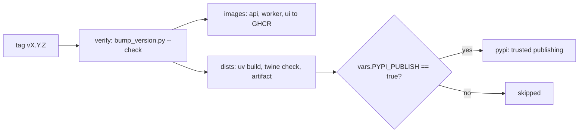

# Releasing

> Status: Phase 10. The version script and the workflow's guard, build and check are tested; the
> distributions were built and checked locally. No release has yet gone through this workflow, and
> PyPI publishing is switched off until the owner sets it up.

A release is a tag. Pushing `vX.Y.Z` runs `.github/workflows/release.yml`, which refuses a tag that
does not match the code, publishes the container images to GHCR, builds the Python distributions,
and uploads them to PyPI only when that has been switched on.

## Cutting a release

1. Update `CHANGELOG.md`: move `[Unreleased]` under the new version and date.
2. Move every version in one step, then refresh the lock file:

   ```bash
   python scripts/bump_version.py 0.5.0
   uv lock
   python scripts/bump_version.py --check v0.5.0     # the same check the workflow runs
   ```

   The script sets the version of the four packages (`ragfabric-core`, `ragfabric-server`,
   `ragfabric-sdk`, `ragfabric`), every exact pin between them (extras included),
   `ragfabric_core.__version__`, and the default image version in `deploy/compose/`. Pre-releases
   use PEP 440 spelling: `1.0.0rc1`, tagged `v1.0.0rc1`.
3. Commit, merge to `main` through a pull request, then tag the merge commit and push the tag:

   ```bash
   git tag -a v0.5.0 -m "v0.5.0"
   git push origin v0.5.0
   ```

## What the workflow does



| Job | Does | Needs |
|---|---|---|
| `verify` | Fails unless every version and pin equals the tag | nothing |
| `images` | Builds and pushes `ghcr.io/<repo>/api`, `worker` and `ui`, tagged with the version and the commit | `verify` |
| `dists` | `uv build --all-packages`, `twine check --strict`, and attaches the wheels and source archives to the run as the `dists` artifact | `verify` |
| `pypi` | Uploads the `dists` artifact to PyPI | `dists`, and the variable below |

A failed `verify` stops everything: nothing is built from a tag that disagrees with the code. Fix
the versions, delete the tag (`git push origin :refs/tags/v0.5.0`), and tag again.

## Switching on PyPI publishing (owner, once)

The `pypi` job uses PyPI trusted publishing, so no token is stored in the repository.

1. On PyPI, for each of the four projects, add a trusted publisher: this repository, workflow
   `release.yml`, environment `pypi`. For a project that does not exist yet, add it as a pending
   publisher.
2. In the repository settings, create the environment `pypi`. Adding a required reviewer means
   every upload waits for a person to approve it.
3. Set the repository variable `PYPI_PUBLISH` to `true`.

Until all three are done the `pypi` job is skipped and the distributions remain available as the
run's artifact, to inspect or upload by hand.

Uploads to PyPI cannot be replaced: a version, once uploaded, is used up even if deleted. That is
why the tag check runs first.
